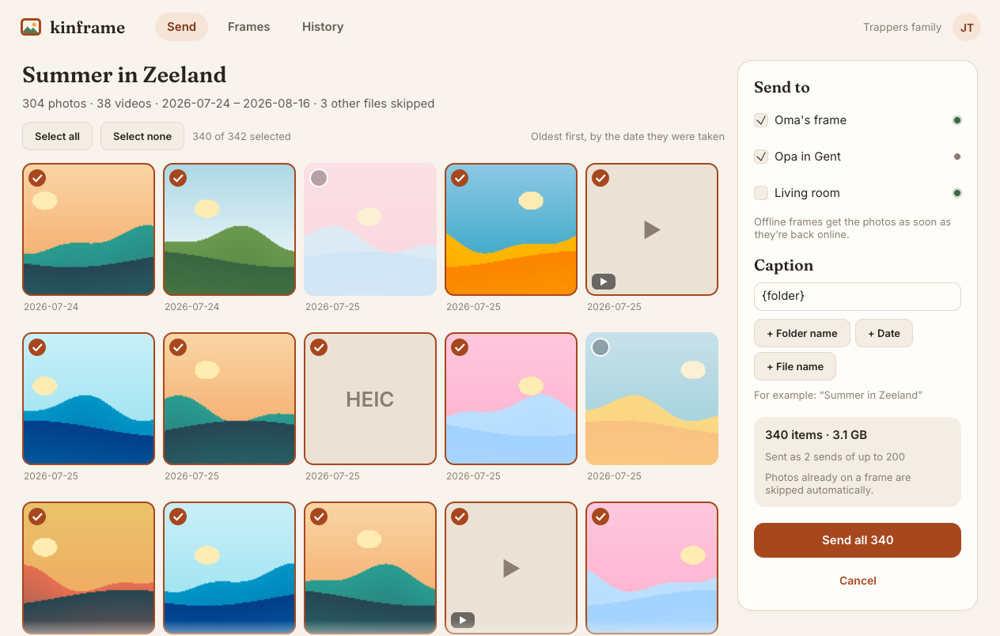
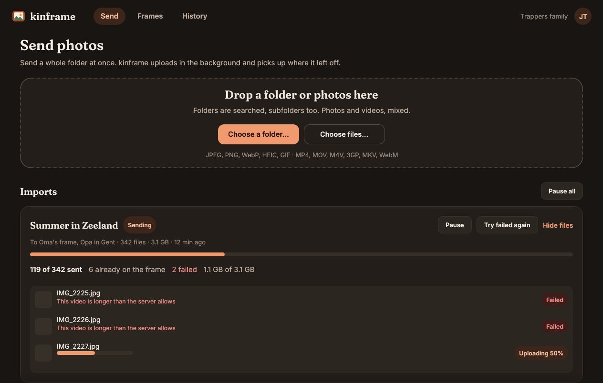
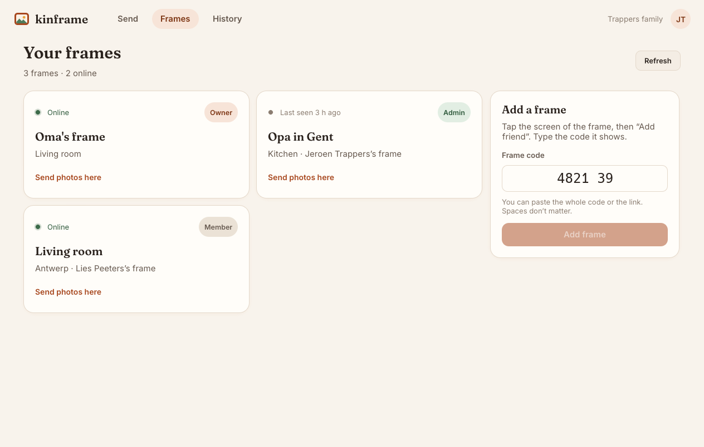
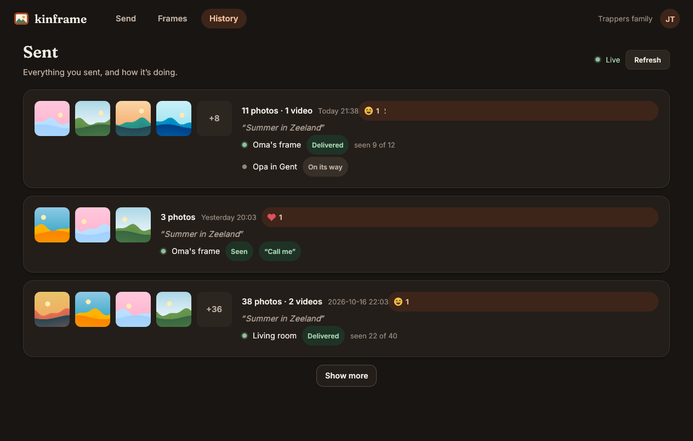

# kinframe desktop

The kinframe client for **Windows, macOS and Linux**, in Rust with [egui](https://github.com/emilk/egui). It does
what the web and phone apps do for sending (sign in, frames, send, history), and adds **bulk import**: send a whole
folder or album at once, with progress, duplicate detection and uploads that survive quitting the app.

| Light | Dark |
|---|---|
|  |  |
|  |  |

More in [`docs/screenshots/`](docs/screenshots) (welcome, every screen in both themes, Dutch).

## Build and run

Rust 1.88 or newer (`rustup` or your distribution's toolchain).

```sh
cd desktop
cargo run --release                 # the app
cargo run --release -- ~/Pictures/Zeeland   # open with a folder (also what "Open with kinframe" does)
cargo test                          # unit tests, incl. tus/OIDC/engine against mock servers
cargo clippy --all-targets -- -D warnings && cargo fmt --check
```

Linux needs the usual windowing libraries (`libxkbcommon`, Wayland or X11, Vulkan or OpenGL) and, for the folder
picker, `xdg-desktop-portal`. The refresh token goes to the Secret Service (GNOME Keyring, KWallet); without one the
app still works but asks you to sign in again after a restart.

### Against a local server

Run the Go server in dev-auth mode (`server/README.md`), then choose "Use your own server" and enter its address.
Development servers offer a password-less "Development server" sign-in.

```sh
KINFRAME_E2E_URL=http://127.0.0.1:8131 cargo test --test e2e -- --ignored --nocapture
```

runs an end-to-end bulk import against such a server: it enrolls a fake frame, claims it with its code, imports a
folder through the real engine (tus uploads, batched sends), imports it again (all duplicates), and checks the
server's `Kinframe-Existing-Item` answer.

### Screenshots

```sh
cargo run --example screenshots -- docs/screenshots 1.0
```

renders every screen with made-up data offscreen (wgpu, no window or server). `KINFRAME_SCREENSHOT=out.png` makes
the real app save a screenshot of its window after five seconds and quit; `KINFRAME_DESKTOP_HOME=<dir>` keeps all of
its files in one directory.

## How it works

```
src/
  discovery.rs   GET /.well-known/kinframe, URL normalization (typos, pasted links)
  auth/          Logto sign-in (RFC 8252 loopback + PKCE), token refresh, keychain, dev auth
  api.rs         REST client: problem+json errors, 401 → refresh → retry once, Idempotency-Key
  scan.rs        recursive folder scan, EXIF and QuickTime capture dates, oldest first
  dedupe.rs      SHA-256 and the local "sent to which frame" index
  tus.rs         tus 1.0 client: create, HEAD to resume, 4 MiB PATCH chunks, 409/404 recovery
  queue.rs       the persistent import queue (jobs, files, send batches) — pure state, unit-tested
  prepare.rs     the "prepare before upload" hook; uploads originals today
  engine.rs      runs the queue: 3 uploads in parallel, batching, retries, pause/resume
  live.rs        the user websocket with reconnect back-off
  i18n/          English and Dutch tables
  ui/            egui screens, theme (the web's design tokens), thumbnails, demo data
```

A tokio runtime runs network and file work; the egui thread only reads shared state and receives messages, so the
UI never blocks.

### Sign-in

Authorization Code + PKCE in the **system browser** with a **loopback redirect** (`http://127.0.0.1:<random
port>/callback`, RFC 8252 §7.3). Logto (1.43, oidc-provider) ignores the port of loopback redirect URIs for
*Native* applications, so `bootstrap-logto` registers a dedicated **"kinframe desktop"** Native app with just
`http://127.0.0.1/callback`, and discovery publishes its id as `auth.desktop_client_id`. Servers that predate it
lack the field; the app then says the server needs an update. Scopes are `openid profile email offline_access` for
the API resource; the refresh token lives in the OS keychain (Keychain, Credential Manager, Secret Service via the
`keyring` crate) and is rotated on every refresh. Sign-out revokes it (Logto has no port leniency for post-logout
redirects, so there is no browser round trip); the next sign-in then asks for the account (`prompt=login`).

If the account still has the server's placeholder name, the app takes the ID token's `name` claim or asks once.

### Bulk import

1. **Pick or drop** folders and files. Folders are scanned recursively (hidden folders, `@eaDir`, `__MACOSX` are
   skipped) for jpg, jpeg, png, webp, heic/heif, gif, mp4, mov, m4v, 3gp, mkv and webm.
2. Files are **dated** from EXIF `DateTimeOriginal` (+ `OffsetTimeOriginal`), the QuickTime `mvhd` creation time,
   or the file time, and **sorted oldest first** so a trip arrives in order.
3. A **preview grid** (thumbnails decoded in the background with EXIF orientation, only for what's on screen) lets
   you deselect files. Choose target frames and an optional **caption template** (`{folder}`, `{date}`,
   `{filename}`).
4. "Send" turns the selection into a **job** in the queue (`queue.json` in the OS data directory, written
   atomically about once a second while work happens). Each file is:
   - **hashed** (SHA-256 of the original);
   - checked against the **local sent index** (`sent-index.json`: server → hash → frames). A file every target
     frame already has becomes "Already there"; otherwise only the frames that miss it get it;
   - **prepared** (`prepare.rs`; originals for now, client-side resizing slots in here);
   - **uploaded with tus**, 3 files at a time. The creation request carries the hash; if the server answers
     `Kinframe-Existing-Item`, nothing is uploaded and the existing item is sent. The upload URL and confirmed
     offset are persisted, so after a crash, pause or restart the upload continues with a `HEAD`.
5. Uploaded files are grouped into **sends** by target-frame set, at most `limits.max_items_per_send` per send. Each
   batch gets an `Idempotency-Key` that is saved *before* the request, so a retry after a crash can't send twice.
   Full batches go out right away; the remainder when no more uploads can join it.
6. **Errors** are per file: network errors and 5xx retry with back-off (up to 6 times); permanent ones
   (`upload_too_large`, `unsupported_media`, `video_too_long`, missing permission) mark the file failed with a clear
   message. "Try failed again" re-queues them. Expired uploads (`upload_not_found` on send) are re-uploaded.
7. Jobs can be paused and resumed (individually or all). A finished job shows a notification and refreshes History.

### History

`GET /v1/sends` for the list, kept live by the user websocket (`send.updated` refetches that send; reactions update
in place; frame online state updates the Frames tab). It reconnects with 1 s → 60 s back-off and ±20 % jitter, and
refreshes everything after reconnecting.

### Design and accessibility

Colours are the web's tokens (`web/src/app.css`), light and dark following the OS. Headings use Fraunces, text uses
Inter; both are under the SIL Open Font License and bundled in `assets/fonts` (instanced and subset to Latin, see the
OFL files). Everything is reachable by keyboard (Tab/Shift+Tab, Space/Enter, Esc closes the preview; Ctrl/⌘+1–3
switch tabs, Ctrl/⌘+O picks a folder) and egui exposes the UI to screen readers through AccessKit. HiDPI is
automatic.

### Languages

`src/i18n/en.rs` is the source of truth; `nl.rs` must have exactly the same keys and placeholders (tests check
this, and that every key the UI uses exists). To add a language, copy `nl.rs`, translate it (the web catalogs in
`web/src/lib/i18n/catalogs` have most of the wording), and add it to `Lang` in `src/i18n.rs`.

## Packaging

[cargo-packager](https://github.com/crabnebula-dev/cargo-packager) builds the installers from
`[package.metadata.packager]` in `Cargo.toml`:

```sh
cargo install cargo-packager --locked --version 0.11.8
cargo build --release --target x86_64-unknown-linux-gnu
cargo packager --release --target x86_64-unknown-linux-gnu --formats appimage,deb   # Linux
cargo packager --release --target x86_64-pc-windows-msvc --formats nsis,wix         # Windows
cargo packager --release --target aarch64-apple-darwin --formats app,dmg            # macOS
```

Output goes to `target/packages/`. The Linux desktop entry (`packaging/kinframe.desktop`) registers kinframe for
"Open with" on photos, videos and folders.

CI (`.github/workflows/desktop.yml`) runs fmt, clippy and tests, then builds artifacts on GitHub runners:
`kinframe-desktop-linux-x86_64` (AppImage, .deb), `kinframe-desktop-windows-x86_64` (NSIS .exe, .msi) and
`kinframe-desktop-macos-aarch64` / `-macos-x86_64` (.dmg). Tags `desktop-v*` build the same.

### Signing (follow-up)

Builds are **unsigned** for now: macOS Gatekeeper and Windows SmartScreen will warn.

- **macOS**: sign with a Developer ID Application certificate of the **Appmire** Apple team and notarize. The plan:
  repository secrets `APPLE_CERTIFICATE` (base64 .p12), `APPLE_CERTIFICATE_PASSWORD`, `APPLE_SIGNING_IDENTITY`,
  `APPLE_TEAM_ID`, `APPLE_ID` and `APPLE_PASSWORD` (app-specific), imported into a temporary keychain in the macOS
  job; cargo-packager's `macos.signing-identity` signs the .app and `notarytool` notarizes and staples the .dmg.
- **Windows**: Authenticode-sign the .exe/.msi (cargo-packager's `windows.sign-command`, e.g. Azure Trusted Signing
  or a code-signing certificate from secrets).
- **Linux**: optionally a detached GPG signature for the AppImage; the .deb could go into an apt repository.

## Not yet

- Signing and notarization (above), auto-update, a universal macOS binary, an ARM64 Windows/Linux build.
- Client-side preparation (downscaling to the master size before upload; `prepare.rs` is the hook).
- More languages (the 34 others from the web catalogs), right-to-left layout.
- Per-item captions, focal point and video trimming; managing frames (settings, members, invites), albums and
  the library; unsend and caption edits from History; notifications when the app is closed.
