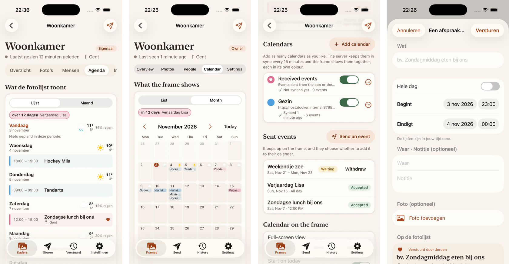
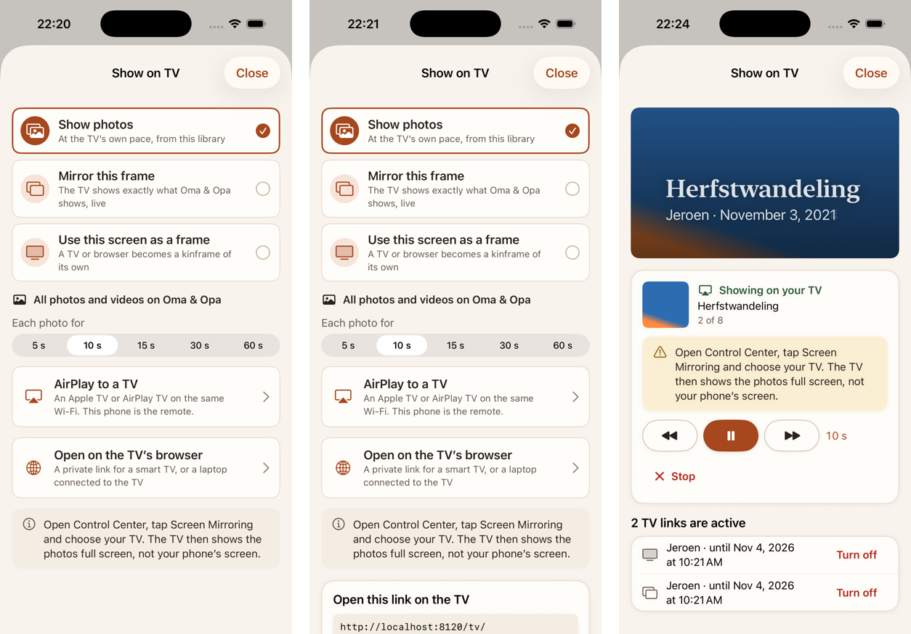
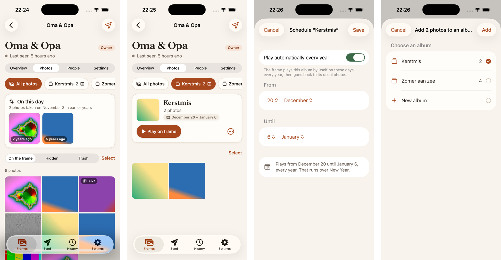
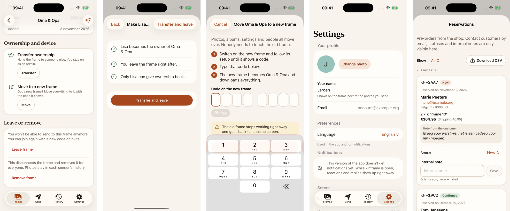

# iOS family app: SwiftUI app, share extension, background uploads, and Universal Links on the server

## Update: feature parity with the web app (November 2026)

Every user-facing part of the web app (routes, frame tabs, settings sections, dialogs) was compared with the app, and
what was missing is now in. The web app stays the reference for behaviour and wording: the shared strings come from
its catalogs (English and Dutch), and iOS-only strings are in `ios-strings*.json` (`strings.py` now also reads one
file per area, `ios-strings-<area>.json`).

### Parity, feature by feature

| Web | iOS before | iOS now |
|---|---|---|
| Frames list, add a frame, `/f/<code>`, `/i/<token>` | yes | plus the Browser badge and the convert hint (opens the web's `/convert` in Safari) |
| Send (composer, framing, trim, captions) | yes | plus Fit and trim badges, "Keep the whole video", the "applied to all" note |
| History, a send's detail | yes | plus Share per item and Show on TV |
| Frame overview: remote, health, details | read-only details | edit name and location; owners can Leave (transfer first); Ownership: transfer (also leave, remove my photos, confirm step) and **Move to a new frame** (replace device) |
| Frame library | photos, hide, trash, share | plus **albums** (chips, album view, play on the frame, schedule, arrange, rename, delete, add/remove, cover), **On this day**, counts, Select all, Show on TV |
| People | yes | plus Make owner, Copy link, Undo after revoking an invite |
| **Calendar tab**: calendars, what the frame shows, countdowns, sent events, calendar settings | none | all of it (below) |
| Frame settings | yes, with plugins | plus play an album, On this day, the frame's language, the note for browser frames |
| **Show on TV** (library, album, selection, photo, send) | none | TV links, mirror, another screen as a frame, AirPlay (below) |
| Settings: profile, language, server, sign out | yes | plus Notifications (APNs), Signed in as, Privacy and Terms, Reserve a frame, and the operator's **shop reservations** |
| Media preparation | app only | also in the share extension; originals are never uploaded |

Not in the app, on purpose:

- **Convert an old tablet** (`/convert`): it drives the tablet over USB from a computer (WebUSB, adb). A phone can't;
  the add-frame screen points to the web page instead.
- **This browser as a frame** (`/tv/frame`, "Use this browser" in the TV dialog): a phone in a pocket isn't a frame.
  "Use another screen" (claiming the code a TV shows) is in.
- **The TV page itself** (`/tv/<frame>`): it's what the TV opens; the app makes the links and plays to AirPlay.
- **The storefront, shop checkout and cancel pages, the public weather station pages, the callback page**: public web
  pages for buyers, or part of the web sign-in. The app links to the shop when the server has one; discovery says
  nothing about public stations, so there's no link to them yet.
- **Drag-and-drop and folder upload**: web-only ways to pick files.
- **The web push offer card**: the app asks iOS for permission after the first send (behind the APNs flag).

### Calendar

The fifth section of a frame page, shown when discovery has `calendar` and you may send or change settings (with
five sections the section picker becomes a scrolling row so Dutch labels fit).

- **What the frame shows** (change_settings): a list (today and every day with events, multi-day events once) or a
  month (week numbers, the first day of the week from the frame's locale, past days faded), the daily forecast, the
  countdown chips, times in the frame's time zone. An event opens with its calendar, time, place, who sent it and
  notes; managers switch **Count down on the frame** there (`PUT/DELETE …/countdowns/{eventId}`).
- **Calendars**: add an ICS link or a CalDAV account (test the connection, pick one or more of its calendars, name
  and colour from the 12-colour palette), show or hide, sync now, edit, remove; while a sync runs the list refreshes
  every 3 s, like the web.
- **Sent events**: send an event (title, all day or times in your time zone, place, note, an optional photo above or
  behind, and a preview of the card the frame shows), see Waiting / Accepted / Declined / Withdrawn, withdraw your own
  (managers anyone's). `event_invitation.decided` on the websocket updates the list and tells the sender with a
  toast anywhere in the app. The photo is prepared like every upload (`PhotoUpload`: photo-master-v1, tus in the
  foreground).
- **Calendar on the frame**: full-screen view, start on today, fade past events, week numbers, the calendar sidebar,
  countdown widgets, the sync window and timed views, saved as a merge patch with `If-Match` like the other settings.

### Show on TV, and why AirPlay

The web casts with Google Cast, the Presentation API or Remote Playback. None of these exist on iOS (the Cast web SDK
doesn't run in WebKit). The app uses what an iPhone has:

- **AirPlay through an external display scene.** When the phone is mirrored to an Apple TV (Screen Mirroring), the
  app declares the external display role and, only while a TV session runs, puts its own window on the TV: the
  slideshow plays natively from a `cast` link (`GET /v1/tv/{token}`, photos with caption and byline, videos to the
  end, signed URLs refreshed in place) and the phone is the remote (previous, pause, next, interval, stop, which
  revokes the link). A mirror loads the frame's TV page in a web view on the TV, with the frame remote on the phone.
  Without a session the app creates no window there, so iOS keeps mirroring the phone as usual.
- **TV links** for every other TV: "Open on the TV's browser" makes a `tv` or `mirror` link with Copy, Share (share
  sheet) and Open, "Works until …", and the list of active links with Turn off.
- **Use another screen as a frame**: type the code the TV's browser shows.

Entry points: the library (all photos), an album, a selection, a photo, and a send in History.

### Albums and On this day

Album chips over the library ("All photos", each album with its count, the playing and scheduled marks, New album for
library managers), an album in its own order with a header (cover, count, Playing, schedule), Play on the frame / Show
all photos (`slideshow.album_id`), Arrange (drag to reorder), a yearly Schedule (from–to, clamped days, over New Year),
Rename, Delete; add to an album (existing or new) and remove (Undo) from the selection bar and the photo sheet, Make
cover. Album edits use `If-Match`; a `version_conflict` reloads the album and says so. Clearing a schedule needs
`"schedule": null`, which the generated client can't send, so album writes go as plain JSON. On this day: a strip
of photos taken on this date in earlier years, with "N years ago".

### Overview, people and settings

Details are editable; owners get Leave (transfer, then leave) and an Ownership section with Transfer and **Move to a
new frame** (`POST …/replace-device` with the new frame's code: steps, the code field from add-frame, the warning,
the done state). People: Make owner, Copy link, Undo after revoking an invite (a deferred toast like the web's).
Settings: Notifications (a switch when APNs is built in, otherwise a line saying this version doesn't get them yet;
with permission denied, a note and Open Settings), Signed in as, Privacy and Terms (the server's web pages), Reserve
a frame (when the server has a shop), and for operators **Reservations**: filter, totals, CSV export through the
share sheet, status per reservation (saved right away) and an internal note.

### How it was checked

- 137 unit tests, all passing (49 new since the last update): calendar dates, spans in the frame's time zone,
  agenda, month grids, ISO weeks, countdowns, weather, colours, addresses, the send-event form, the decided event,
  the calendar model against a stub server, the event photo upload (prepared, and refused when it can't be); TV
  scopes, link bodies, steps, dwell, refresh and keep-place, the page URL; album ordering, schedules, On this day;
  transfer, details, reservations and web links; and the always-prepare rules (above).
- Against the dev server built from this branch (own database): an ICS calendar served from the Mac and synced by the
  server, events sent and accepted by a scripted frame, a countdown, the weather for the frame's place; TV links
  made, listed and turned off, an AirPlay session with the stage shown in the app; albums created, scheduled and
  played on the frame, On this day with back-dated photos; the overview, transfer, move and people screens, and the
  reservations screen against a temporary server with a shop.
- Screenshots on the iPhone 17 simulator, English and Dutch (above).

### Left after this update

- **AirPlay on a real TV:** no Apple TV was at hand and the Simulator's external display couldn't be attached from
  the command line, so the TV side was checked with the stage shown inside the sheet (`-kfTvStage YES`). The mirror's
  TV page needs the web app, which the dev server doesn't serve.
- Add and remove from an album, a reservation's status change, the CSV download and moving to a new frame were
  checked against a stub server, not by tapping through on the dev server.
- **Device:** `DEVELOPMENT_TEAM` is still empty and the iPhone wasn't available, so nothing ran on a device.

### Questions about this update

6. AirPlay needs Screen Mirroring to be on before "AirPlay to a TV". Is that acceptable, or should the app also offer
   Google Cast through the native Cast SDK (a dependency and Google's terms)?
7. Should the app link to the public weather station pages? Discovery would need to say whether the server has them.
8. The Calendar tab adds a fifth section; should Calendar rather sit inside Settings on a phone?

## Update: up to date with main (November 2026)

`origin/main` is merged in (181 commits since the branch point; one conflict in `server/internal/config/config.go`,
where both sides added fields: kept both). The API client and the string catalog are regenerated from main, and the
app has caught up with what the Android family app and `docs/ios-handoff.md` added since:

- **Media preparation and Live Photos** (handoff "Media preparation and Live Photos"): the upload queue prepares
  every photo as `photo-master-v1` and every video as `video-master-v1` before tus, and the composer picks Live Photos
  with their clip, sent as `kind: live` or as a still only.
- **Share to another frame** (handoff addendum): from the library and from a send in History, with a dry run,
  "Already there" / "Has some", Undo and "Shared by".
- **Plugins** in the frame settings, including the split layout ("Two photos and a dashboard") and community plugins
  from the registry, and the slideshow's **Live photos** setting.

Not added in that update: calendars, countdowns and TV links (they are in now, see the parity update above).

### What the update does

- **Preparation** runs in the upload queue (`OutboxRunner`, an actor, not the main actor), in the app and in the share
  extension. Photos: capture time from EXIF `DateTimeOriginal` + `OffsetTimeOriginal` (as UTC without an offset),
  one ImageIO decode-and-downscale step (long edge 2560, EXIF orientation applied, never upscaled), redrawn in 8-bit
  sRGB, written with no source properties (JPEG 0.9; WebP if ImageIO ever lists it as an encoder). Videos: an
  `AVMutableComposition` with the trim and, when muted, without audio; a video composition that bakes the rotation in
  and renders at most 1920×1080 and 30 fps; `AVAssetExportPreset1920x1080` to MP4 with network optimization,
  `metadata = []` and `.forSharing()`. The send gets `captured_at`, `width`, `height`, `duration_ms` and no `trim`
  for a prepared video. "Preparing 2 of 5 · 40%" shows in the sending card. The master replaces the original in the
  queue; both are gone once the send is accepted.
- **Originals are never uploaded.** Every file of a send is prepared, one at a time, before any upload starts. When
  preparing a file fails, it goes as it is only if it's already within the master's limits (long edge ≤ 2560 px;
  ≤ 1920×1080 and ≤ 30 fps); otherwise the send stops with "A photo or video couldn't be made ready to send, and it's
  too large to send as it is." (`media_unprepared`) and Try again / Cancel. The same goes for Live Photo clips. GIF and
  BMP are prepared too (a GIF becomes its first frame, which is all the server keeps of it).
- **Live Photos:** the picker matches `.livePhotos`; for a Live Photo the app loads `PHLivePhoto` and writes its
  `.pairedVideo` resource with `PHAssetResourceManager` (iCloud allowed), without asking for library access. The
  clip is prepared like a video, muted and cut to 10 s, uploaded on its own, and sent as `live_video_upload_id`.
  "Live" badge on the composer tile, a "Send as a still photo only" switch in the item editor, "Live" badges in
  History and the library, and a long press there plays `GET /v1/items/{id}/media/motion`, muted (the redirect to the
  signed URL is followed without our token; a streamed clip gets the token).
- **The share extension prepares too.** After Send it runs the same queue with the same preparer, one file at a time
  (ImageIO's decode-and-downscale keeps a 48 MP photo well under the extension's memory limit, and the video export
  runs out of process), shows "Preparing 2 of 3 · 40%", and closes once every file is prepared and the uploads have
  started on the background session. A file that can't be prepared and is too large shows the error in the sheet and
  the job is taken out of the queue. If the sheet goes away before preparing is done, the job stays queued and the
  app prepares what's left the next time it runs (after the 90 s lease). An upload of an unprepared original queued by
  an older version starts over with the master.
- **Share to another frame:** `POST /v1/frames/{id}/placements:share` with an `Idempotency-Key`; a dry run over all
  candidate frames (where you can send, not the source) marks "Already there" (not selectable) and "Has some". The
  toast "Shared to …" has Undo, which purges the created placements per frame. Entry points: the library's selection
  bar, the photo sheet, and a send's detail (source: the first frame that still has every item). "Shared by …" in the
  photo sheet, as a mark on library tiles, and per frame in a send's delivery.
- **Plugins:** layout (off, on the photo, beside the photo with side and background, two photos and a dashboard with
  side), the instances with status ("Waiting for the frame", errors, "Not on this frame", withdrawn from the
  registry, an update waiting) and on/off (an incomplete one opens its form instead), "Add plugin" with built-in and
  community plugins, what a community plugin may do before it's added, and the editor: every manifest setting type
  (text, number, url with what the frame found on the network, colour with a swatch, duration, choice, switch,
  secret with Set / Change / Remove, Home Assistant entities with search, time zones with search and UTC offsets),
  presets with `{placeholders}`, corner, visibility, approving or putting off a registry update, remove. The manifest
  translations are used for the app's language. Every change is saved on its own with `If-Match`; a `412` is retried
  once on the newer settings, and a `422`'s field errors show at their fields. The frame's report is refreshed every
  3 s while the editor is open.
- **Frame settings:** "Live photos": play when shown, play on tap, photo only.

### How the update was checked

- 88 unit tests, all passing (26 new): the preparation policy (sizes, bitrate, trim and the 10 s cut, EXIF times),
  a real ImageIO run on a 4000×3000 Display P3 JPEG with GPS and orientation 6 (comes out 1920×2560, sRGB, without
  EXIF date, GPS or orientation), the runner with a fake preparer (prepared still and muted clip uploaded with
  `prepared`, the send body with `live_video_upload_id`, `width`, `height`, `captured_at`; a prepared video without
  `trim` and with `duration_ms`), sharing (coverage from a dry run, targets, the source frame, "Shared by"), and the plugin settings logic
  (manifest reading, the server's checks, presets, instance JSON keeping unknown fields and sending only changed
  secrets, 422 field mapping, status, registry update diffs, the frame's report, entity filters, time zones).
- Against a local dev server built from this branch (Docker, own database) with three scripted frames: a Live Photo
  and a photo sent from the composer were uploaded prepared (the server logged `pipeline=prepared` for the still, the
  photo and the motion clip), a share between frames with the dry-run marks, "Shared by" in History and the library,
  and the Plugins section with a reported catalog (built-in and a community plugin), saving layout changes.
- Screenshots above (iPhone 17 simulator, light; the plugins section also in Dutch).
- Always preparing (6 more tests, 94 in all): the limits for going as-is, read from real files too; a file that
  can't be prepared but is within the limits goes as it is; one that is too large fails the send with
  `media_unprepared` before anything is uploaded, also when it's a Live Photo's clip; every file is prepared before
  the first upload; an unfinished upload of an original starts over with the master; the share sheet waits until
  every file (and clip) is prepared. On the dev server, the share sheet (in-app preview) sent a 4800×3600 JPEG and a
  video: the queue uploaded a 2560×1920 master and a 1440×1080 MP4, and the server logged `pipeline=prepared` for both.

### Left after the update

- **Device:** `DEVELOPMENT_TEAM` is still empty and the iPhone SE wasn't reachable, so the update ran on the
  simulator only. Live Photo picking needs a real library: the simulator has no Live Photos, so the picker path
  (`PHLivePhoto` → `.pairedVideo`) is untested; the rest of the Live path was tested with a staged still and clip.
- Video preparation is covered by the policy tests and the dev-server run with a short clip, not by a unit test of
  the export itself.
- Long-press playback of a motion clip wasn't tried in the simulator (it needs a press gesture).

### Questions about the update

4. ~~Should the share extension upload originals, or leave the job for the app to prepare?~~ Decided: photos and
   videos are always prepared on the device and originals are never uploaded. The extension now prepares in the
   sheet before closing (see above), so a share still doesn't wait for the app to be opened.
5. Should Live Photos get a "Live sound" switch? The handoff mentions it; the Android app has none, so the clip is
   always sent muted for now.

## The original pull request

## What this is

The native iOS family app from `docs/ios-handoff.md`, at v0.1 parity with the web app: onboarding with server choice
and Logto sign-in, frames, sending photos and videos (also from the share sheet), history with delivery and
reactions, frame management, and settings. SwiftUI, Swift 6 strict concurrency, iOS 17+. Everything is in `ios/`;
`ios/README.md` covers building, running against a dev server, and the architecture.

The server gets a small `/.well-known/apple-app-site-association` handler for Universal Links, and CI gets an iOS job.

## Screenshots

Light and dark, iPhone 17 simulator, against a local dev server.

Onboarding: welcome, server choice, sign-in, adding a frame (with a wrong code)

Frames, the composer, framing and trim, and the share extension's composer

History, a send with delivery per frame, and settings

A frame: overview with remote control and health, photos, people, settings

## What works

- **Onboarding:** welcome → server (the default, or "Use your own server" validated through `/.well-known/kinframe`,
  showing name and version) → sign-in → the name prompt (only for "New member" accounts) → add your first frame. The
  step is persisted. Dev servers (`dev_auth: true`) get the developer sign-in form.
- **Sign-in:** the Logto Swift SDK, Authorization Code + PKCE in `ASWebAuthenticationSession`, redirect
  `app.kinframe:/callback`, issuer, client id and API resource from discovery, scopes
  `openid profile email offline_access kinframe:operate`. Refresh tokens in the Keychain, shared with the share
  extension through a keychain group; the client is rebuilt from the Keychain before refreshing, so a rotated refresh
  token is never reused by the other process.
- **API client:** generated by `swift-openapi-generator` from `docs/api/openapi.yaml` and checked in
  (`ios/tools/generate-api.sh`; a small specprep inlines deep refs and nullable `oneOf`s). A middleware adds the
  token and `Accept-Language`, retries once after a 401, and maps problems to localized messages by `code`.
- **Frames:** list with online state and roles, empty state; add with the 8-digit code (formatted `1234 5678`, paste
  button, auto-submit when complete) with the claimed / joined / already a member / pending results and naming after
  a claim. Universal Links for `/f/{code}` and `/i/{token}` on `kinframe.appmire.be`, and `app.kinframe://` links
  for any server; a link for another server asks before switching.
- **Send:** PhotosPicker with original files (HEIC, JPEG, PNG, MOV, MP4, …, no library permission), camera capture,
  mixed photos and videos, captions (280, shared or per item, "use for all"), fill/fit with a focal point and
  landscape and portrait previews in the selected frame's shape, video trim (3 s to `max_video_seconds`) and
  "include sound", frames with online state, `max_items_per_send` and the other limits from discovery. After
  sending, the app opens the send in History.
- **Background uploads:** tus 1.0 (creation-with-upload, `PATCH` in 4 MiB chunks, `HEAD` to resume, restart when an
  upload expired, the duplicate shortcut), three files at a time, then `POST /v1/sends` with a persisted
  `Idempotency-Key`. Requests run in a background `URLSession`; each step is persisted in the App Group, and responses
  that arrive after a relaunch are applied to their job. Network failures retry when the app comes back.
- **Share extension:** "Share → kinframe" for images and videos. A compact composer (frames, caption) stages the
  files in the App Group, queues the job and starts it on its own background session, then closes; the app finishes
  it if needed. It remembers the frames last shared to.
- **History:** sends newest first by day, filters, per-frame stage (processing → on its way → delivered → seen),
  reaction and quick-reply chips, the upload queue on top, paging. Send detail with delivery per frame and item,
  caption editing and unsend with undo. Live over `GET /v1/ws?access_token=…` with back-off and reconnect on 4401.
- **Frame detail** by role and permission: overview (online, health from `/health`, details), remote commands (previous,
  next, sleep, wake, identify, sync now), library grid with signed thumbnails and hide / trash / restore (single or
  a selection, with undo), people (join requests with let in / decline, roles and permissions, remove), invite links
  through the share sheet with expiry, uses and a note, revoke; remote settings (interval, order, transition, fill,
  background, captions, clock, brightness, sleep schedules, weather location via `/v1/geocode`, temperature unit) as
  a JSON merge patch with `If-Match` and the web's conflict rebase; leave, remove (type the name) and ownership
  transfer.
- **Settings:** name, avatar (`PUT /v1/me/avatar`), language (system, English, Nederlands; also sets the account
  locale), server details and limits, another server, sign out.
- **Design:** the web tokens (colours, radii) in light and dark, serif headings, 44 pt targets, Dynamic Type styles,
  VoiceOver labels and actions (for example moving the focal point), haptics. App icon from the kinframe mark.
- **Localization:** `Localizable.xcstrings` generated from the web catalogs (same keys, placeholders and plurals) plus
  iOS-only strings, English and Dutch.
- **Push (behind a flag):** with `KINFRAME_APNS_ENABLED = YES` the app asks for permission after the first send and
  registers `POST /v1/me/push-endpoints {kind: "apns"}`. Off by default; see below.
- **Server:** `GET /.well-known/apple-app-site-association` for `<team id>.<bundle id>` with `/f/*` and `/i/*`,
  from `KINFRAME_APPLE_TEAM_ID` and `KINFRAME_APPLE_BUNDLE_ID` (default `app.kinframe.family`); not served without a
  team. Unit and e2e tests; documented in `server/README.md`.
- **CI:** an `ios` job on `macos-latest` builds and runs the unit tests on a simulator without signing.

## How it was checked

- 62 unit tests (`xcodebuild -scheme Kinframe test`): code formatting and validation, discovery parsing and server
  addresses, deep links, send limits and trim, framing maths, merge patches and rebase, delivery stages, the tus state
  machine, the upload runner end to end against a `URLProtocol` fake (chunking, lost response then `HEAD`, resuming a
  job another process started, duplicates, token refresh), and the add-frame, history, frame settings, composer and
  server-choice view models.
- End to end against a local dev server (dev-auth mode, server and media tools in Docker) with a scripted frame that
  enrolls, stays online and acknowledges: claiming through a `/f/` link; sending JPEG, HEIC and MP4 that were
  processed, delivered, seen and reacted to; a send to an offline frame updating live in History when the frame came
  online (seen, 😂, "Miss you"); an invite link accepted by another account and let in from People; a remote command;
  a settings save. UI tests in the `KinframeUITests` scheme cover several of these.
- The share extension from the Photos app, with the app not running: the send arrived, delivered and seen.
- Screenshots of every main screen in light and dark (above).
- Production: the sign-in sheet opens Logto's page for `kinframe.appmire.be` with the client id, redirect and resource
  from discovery. Signing in there wasn't tried: no account was available for testing.

## What's left

- **Signing:** `DEVELOPMENT_TEAM` in `ios/Config/Signing.xcconfig` is empty until the Appmire team is added to Xcode.
  Only simulator builds were made; nothing ran on a device yet.
- **Production sign-in and a real frame:** needs a test account, and a frame code to claim, to try the whole loop on
  `kinframe.appmire.be` and a physical frame.
- **Universal Links in production:** set `KINFRAME_APPLE_TEAM_ID` to the Appmire Team ID on the hosted server
  (deployment repo). Associated domains are fixed at build time, so self-hosted servers use the `app.kinframe://`
  links instead.
- **APNs on the server.** The app side is ready behind the flag. The server needs:
  - an APNs auth key (`.p8`) with its Key ID and the Appmire Team ID, stored as secrets;
  - topic `app.kinframe.family`;
  - to send through `api.push.apple.com` for App Store / TestFlight builds and `api.sandbox.push.apple.com` for
    development builds. `PushEndpointCreate` has no field for the environment; the app could send it (for example in
    `device_name` or a new field), or the server could try production and fall back to sandbox on `BadDeviceToken`;
  - the same events and payloads as the other push kinds (IDs plus a localized title and body).
  Then build with `KINFRAME_APNS_ENABLED = YES` and add the Push Notifications capability.
- **Background wake-ups across processes:** a share whose upload outlives the extension relies on the system waking
  the app for that background session. The code handles it, but the simulator test only covered shares that finished
  while the extension was still running.
- Not in this PR: albums, the moderation queue, "move to new frame", deleting the account, "show now", scanning a
  server QR code at onboarding, the other 34 languages (they follow from `docs/i18n.md`).
- Generated enums reject unknown values; a new server enum value needs the client regenerated.

## Questions

1. Should the share extension preselect the frames shared to last time (current behaviour), or always start empty
   when there's more than one frame?
2. For APNs, which way to tell the server about sandbox vs production tokens (see above)?
3. Is the `app.kinframe://f/<code>?server=<url>` link format fine for self-hosted servers, or should the web app's
   `/f/` page offer an "Open in the app" button with it?
